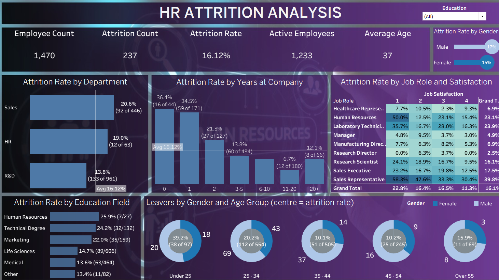

# HR Attrition Analysis Dashboard | Tableau, Excel

## Project Overview

This project analyses employee attrition in an HR dataset of 1,470 employee records (237 leavers) to answer one question: which groups of employees are most likely to leave?

The Tableau dashboard compares attrition rates (leavers ÷ headcount in each group) against the overall rate of 16.12%, across department, years at company, education field, gender, age group, job role and job satisfaction.

**Live dashboard:** [View on Tableau Public](https://public.tableau.com/app/profile/pranav.p.a6131/viz/HRAttritionAnalysisDashboard_17957197242750/Dashboard)

## Dashboard Preview

## Key Insights

- New joiners are the biggest risk: employees in their first two years left at 34.9%, more than twice the 16.12% average
- Under-25s and Sales Representatives have the highest attrition of any age group (39.2%) or job role (39.8%)
- Low job satisfaction is linked to leaving: employees rating satisfaction 1 out of 4 left at 22.8%, versus 11.3% at 4

## Recommendations

If this were real company data, the findings would suggest HR should:

1. Strengthen early-tenure retention: structured onboarding, a mentor for each new joiner, and check-ins at 3, 6 and 12 months, since most risk is in the first two years and among under-25s
2. Review the Sales Representative role: look at workload, targets and pay structure, and use exit interviews to find out why nearly 2 in 5 leave
3. Use satisfaction as an early warning: run regular short surveys and follow up quickly with employees who rate satisfaction low

These are patterns, not proven causes, so each should be investigated further before acting.

## Skills Demonstrated

Data validation (Excel) · KPI analysis · attrition rate analysis · Tableau calculated fields · reference lines · data visualization · dashboard design · documenting findings and limitations

## Business Objective

To identify the employee segments with the highest attrition risk, so HR can see where retention efforts would matter most.

This dashboard compares **group-specific attrition rates** rather than counts, because counts mostly reflect group size: R&D had the most leavers (133) but the lowest attrition rate (13.8%).

## Dataset

| Description | Details |
|---|---|
| Employee Records | 1,470 |
| Leavers | 237 |
| Data Format | Excel |
| Data Categories | Employee demographics, department, education, job role, attrition status and job satisfaction |

The dataset is used for educational and analytical practice. Its original publisher and reuse licence have not yet been independently verified.

## Data Validation

Before building the dashboard, the data was checked in Excel on a separate **Data_validation** sheet (the HR data sheet was left unchanged):

| Check | Result | What it confirms |
|---|---|---|
| Total records | 1,470 | Matches the row count Tableau loaded |
| Missing values | 0 | No blank cells in any column |
| Duplicate rows | 0 | No row appears twice |
| Leavers (Attrition = Yes) | 237 | Matches the Attrition Count KPI in Tableau |

The overall attrition rate (237 ÷ 1,470 = 16.12%) matches the KPI shown on the dashboard.

## Dashboard Contents

The dashboard is built from seven worksheets:

| Worksheet | What it shows |
|---|---|
| KPI | Total employees, attrition count, overall attrition rate, active employees and average age |
| Attrition Rate by Department | Attrition rate per department, with the 16.12% overall rate as a reference line |
| Attrition Rate by Years at Company | Attrition rate by tenure group (0, 1, 2, 3–5, 6–10, 11–20, 20+ years), with the overall-rate reference line |
| Attrition Rate by Education Field | Attrition rate per education field, sorted highest to lowest |
| Attrition Rate by Gender | Attrition rate for male and female employees |
| Leavers by Gender and Age Group | Count of leavers by gender within each age group; the centre of each donut shows that age group's attrition rate |
| Attrition Rate by Job Role and Satisfaction | Heatmap of attrition rate by job role and job satisfaction rating (1–4) |

Each rate label shows the rate with the underlying count, for example **20.6% (92 of 446)**, so small groups are easy to spot.

**Interactive filter:** an Education dropdown filters the dashboard by education level.

## Key Findings

Overall attrition rate: **16.12%** (237 of 1,470 employees).

### 1. Early tenure carries the highest risk
| Years at company | Attrition rate |
|---|---|
| 0 | 36.4% (16 of 44) |
| 1 | 34.5% (59 of 171) |
| 2 | 21.3% (27 of 127) |
| 3–5 | 13.8% (60 of 434) |
| 6–10 | 12.3% (55 of 448) |
| 11–20 | 6.7% (12 of 180) |
| 20+ | 12.1% (8 of 66) |

Employees in their first two years (0–1 years) left at **34.9%** (75 of 215), more than twice the overall rate.

### 2. Under-25s leave at the highest rate of any age group
Under 25: **39.2%** (38 of 97), compared with 20.2% for 25–34 and about 10% for 35–54.

### 3. Sales has the highest departmental attrition rate
| Department | Attrition rate |
|---|---|
| Sales | 20.6% (92 of 446) |
| HR | 19.0% (12 of 63) |
| R&D | 13.8% (133 of 961) |

R&D had the most leavers (133) but the **lowest** rate, because it is by far the largest department.

### 4. Sales Representatives have the highest job-role attrition
Sales Representatives: **39.8%** (33 of 83), compared with 2.5%–6.9% for Research Directors, Managers, Manufacturing Directors and Healthcare Representatives.

### 5. Low job satisfaction is linked to higher attrition
Employees with the lowest satisfaction rating (1) left at **22.8%**, compared with **11.3%** at the highest rating (4). Ratings 2 and 3 were similar (16.4% and 16.5%).

### 6. Education field and gender
- Highest rates: Human Resources 25.9% (7 of 27), Technical Degree 24.2% (32 of 132), Marketing 22.0% (35 of 159). The Human Resources group is small, so its rate is less reliable.
- Male employees: 17.0% (150 of 882); female employees: 14.8% (87 of 588).

## Tableau Calculations

| Calculated field | Purpose |
|---|---|
| Attrition Count | `IF [Attrition] = "yes" THEN 1 ELSE 0 END`: flags each leaver |
| Attrition Rate | `SUM([Attrition Count]) / SUM([Employee Count])`: rate for whatever group is in the view (overall when no dimension is present) |
| Active Employees | Total employees minus attrition count |
| Average Age | Average employee age |
| Age Group | Groups ages into Under 25, 25–34, 35–44, 45–54 and Over 55 |
| Tenure Group | Groups Years at Company into 0, 1, 2, 3–5, 6–10, 11–20 and 20+ |
| Attrition Rate Label | Two-line label: rate, then "(leavers of headcount)" |
| Attrition Rate Label 2 | One-line compact label for tight spaces, e.g. "25.9% (7/27)" |

## Files in This Repository

| File | Contents |
|---|---|
| `HR Attrition Analysis Dashboard.twbx` | Tableau packaged workbook (dashboard and data) |
| `HR Data.xlsx` | Source data (HR data sheet) and the Data_validation sheet |
| `dashboard_screenshot.png` | Dashboard screenshot |
| `README.md` | Project documentation |

## Tools & Technologies

- Tableau Desktop / Tableau Public
- Microsoft Excel (data validation: COUNTBLANK, COUNTA, ROWS, UNIQUE, COUNTIF)
- Tableau calculated fields and reference lines
- GitHub for project hosting and documentation

## Scope & Limitations

- **Practice dataset:** the data is used for educational practice, so the findings illustrate the analysis method rather than a specific real organisation.
- **No time period:** the data has no departure dates or observation window, so 16.12% is the share of records marked as leavers, not a monthly or annual rate, and trends over time cannot be analysed.
- **Small groups:** some groups have few employees (e.g. Human Resources education field: 27; tenure 0 years: 44; some job role × satisfaction cells). Their rates can change a lot with one or two people.
- **Association, not cause:** the analysis shows which groups leave more often, not why. Groups also overlap (younger employees tend to have shorter tenure), so these findings are not independent.
- **Reference line:** the 16.12% line is a fixed value and does not update when the Education filter is applied.

## Next Steps

- Compare attrition rates for other possible drivers in the dataset, such as overtime, business travel, monthly income and years since last promotion.
- Combine two factors (for example, age group × overtime) to find high-risk segments.
- Add a findings and recommendations panel to the dashboard.
