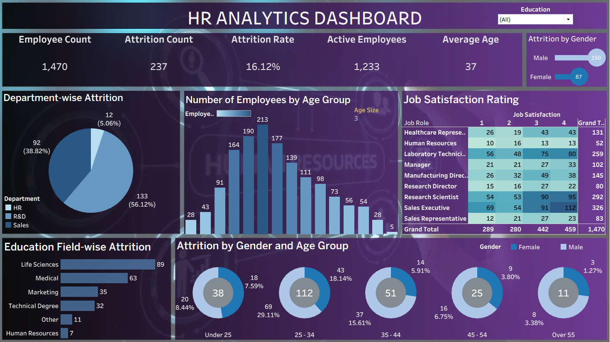

# HR Attrition Analysis Dashboard | Tableau

## Project Overview

This project explores employee attrition patterns using an HR dataset containing 1,470 employee records.

The interactive Tableau dashboard examines employee departures across departments, education fields, gender and age groups. It also presents workforce KPIs, employee age distribution and job satisfaction across job roles.

The project focuses on descriptive HR analysis, dashboard development, calculated fields and data visualization.

## Business Objective

To explore the distribution of employee departures across different workforce segments and identify patterns in the recorded attrition data.

## Dataset

| Description | Details |
|---|---|
| Employee Records | 1,470 |
| Data Format | Excel |
| Data Categories | Employee demographics, department, education, job role, attrition status and job satisfaction |

The dataset is used for educational and analytical practice. Its original publisher and reuse licence have not yet been independently verified.

## Dashboard Preview

## Dashboard Contents

The Tableau workbook contains one interactive dashboard built using seven worksheets.

| Worksheet | Analysis |
|---|---|
| KPI | Total employees, attrition count, overall attrition proportion, active employees and average age |
| Department-wise Attrition | Departure counts by department and share of total departures |
| Education Field-wise Attrition | Departure counts across education fields |
| Gender-wise Attrition | Comparison of departure counts between male and female employees |
| Age and Gender Analysis | Distribution of departures across age groups and gender |
| Job Satisfaction | Employee distribution across job roles and satisfaction ratings |
| Age Distribution | Distribution of employees across age groups |

**Interactive Filter:** An Education dropdown filter allows users to explore the dashboard by education category.

## Key Findings

### Overall Workforce

- Total employees: **1,470**
- Employees who left: **237**
- Active employees: **1,233**
- Overall attrition proportion: **16.12%**

### Department-wise Departures

| Department | Departures | Share of Total Departures |
|---|---:|---:|
| R&D | 133 | 56.12% |
| Sales | 92 | 38.82% |
| HR | 12 | 5.06% |

R&D accounted for the largest share of recorded departures, followed by Sales and HR.

### Age-group Analysis

- Employees aged **25–34** recorded the highest number of departures, with **112 cases**.
- The dashboard also compares departure distributions across age groups and gender.

### Education Field Analysis

- Life Sciences recorded the highest number of departures (**89**).
- Medical followed with **63** departures.
- Marketing accounted for **35** departures.

### Gender Analysis

- Male employees accounted for **150** departures.
- Female employees accounted for **87** departures.

### Job Satisfaction

The dashboard displays employee distribution across job satisfaction ratings and job roles. This provides a descriptive overview of satisfaction levels across roles but does not independently establish a relationship between satisfaction and attrition.

## Tableau Calculations

The workbook uses calculated fields to derive the following metrics:

| Calculated Field | Description |
|---|---|
| Attrition Count | Counts employees recorded with an attrition status of Yes |
| Attrition Rate | Calculates attrition count as a proportion of total employee records |
| Active Employees | Calculates the number of employees remaining |
| Average Age | Calculates the average employee age |
| Age Group | Categorizes employees into age groups |
| Attrition Count and Percentage | Uses a Tableau table calculation to display departure counts and their share of total departures |

**Metric clarification:** Department-wise percentages represent each department's share of total departures, not its department-specific attrition rate. The overall attrition proportion is calculated from the available employee records; the dataset does not specify a departure observation period.

## Tools & Technologies

- Tableau Desktop
- Microsoft Excel
- Tableau Calculated Fields
- Table Calculations
- Data Visualization
- GitHub for project hosting and documentation

## Scope & Limitations

- The analysis is based on a single HR dataset and focuses on descriptive employee attrition patterns.
- The dataset does not include employee departure dates or a defined observation period; therefore, time-based attrition trends cannot be analysed. The overall attrition percentage represents the proportion of employee records marked as attrition cases, not a monthly or annual rate.
- Department-wise percentages represent each department's share of total departures, not its department-specific attrition rate.
- Education-field and gender comparisons primarily use departure counts rather than group-specific attrition rates. The age and gender visualization also displays the distribution of departures across these groups.
- The job satisfaction visualization shows employee distribution across job roles and satisfaction ratings; it does not compare satisfaction levels between employees who left and those who stayed.
- The analysis identifies patterns within the dataset but does not establish the causes of employee departures.
